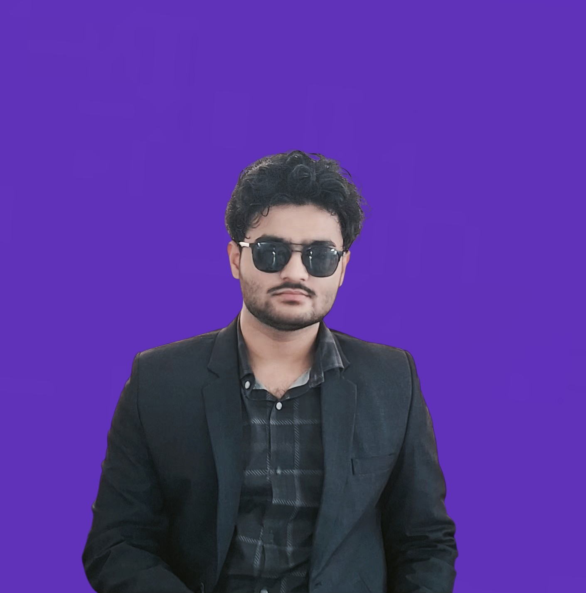

 

### Data Science student. AI builder. Designer at heart.
*I turn ideas into working products, and data into decisions.*

 

 

## ⚡ What I do

| | |
|:--|:--|
| 🧠 **AI engineering** | Learning and building LLM apps, with RAG pipelines as my current focus |
| 📊 **Statistics and data** | First-year Statistics and Data Science at Jahangirnagar University |
| 🛠️ **Product building** | I ship real apps under my own studio, RanFy Inc. |
| 🎨 **Design and sound** | Graphic design and music production, so what I build looks and feels right |

 

## 🚀 What I'm building

<table>
<tr>
<td width="50%" valign="top">

**ExpendFy**
Expense tracking app from RanFy Inc.

</td>
<td width="50%" valign="top">

**PidiFie**
My own Acrobat-style PDF reader and editor

</td>
</tr>
<tr>
<td width="50%" valign="top">

**RAG from scratch**
A retrieval-augmented generation system built step by step with ChromaDB and Groq

</td>
<td width="50%" valign="top">

**Fresh Texfy · RoaFy**
More products in the RanFy Inc. lineup

</td>
</tr>
</table>

 

## 🧰 Tools I work with

 

## 📈 GitHub activity

 

## 🎬 Beyond code

- 📺 Critical Thinking
- 🔬 General member of **JURS**, the JU Research Society

 

## 📬 Let's work together

I'm open to freelance work and collaborations in AI and product building.

 

